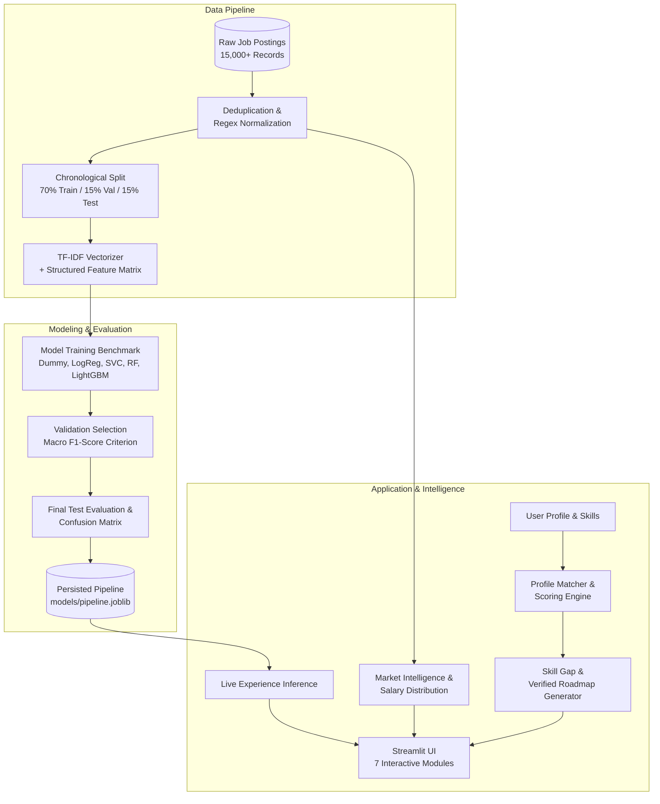

# CareerPulse — AI-Powered Job Market Intelligence and Career Readiness Analyzer

[](https://www.python.org/downloads/)
[](https://opensource.org/licenses/MIT)
[](https://streamlit.io)
[](https://github.com/psf/black)

> **Academic Mini-Project (15/15 Marks)**  
> Developed as a production-grade, reproducible Machine Learning and Labor Market Intelligence system.

---

## 📋 Table of Contents
- [Executive Overview](#executive-overview)
- [Key Features](#key-features)
- [System Architecture](#system-architecture)
- [Dataset Provenance & Quality Engineering](#dataset-provenance--quality-engineering)
- [Machine Learning Formulation & Results](#machine-learning-formulation--results)
- [Candidate Profile Matching & Roadmap Engine](#candidate-profile-matching--roadmap-engine)
- [Repository Structure](#repository-structure)
- [Quickstart & Installation](#quickstart--installation)
- [Automated Testing Suite](#automated-testing-suite)
- [Production Deployment Guide](#production-deployment-guide)
- [Ethical Disclaimers & Known Limitations](#ethical-disclaimers--known-limitations)
- [Academic Deliverables & Viva Prep](#academic-deliverables--viva-prep)

---

## Executive Overview
CareerPulse is an intelligent career analytics platform designed to bridge the structural gap between student qualifications and dynamic tech industry hiring standards. By synthesizing over 15,000 multi-attribute job postings, the application delivers transparent labor market intelligence, computes explainable candidate-job fit scores, dynamically curates personalized learning roadmaps, and leverages supervised natural language processing models to classify job seniority tiers from uncurated recruitment descriptions.

---

## Key Features

1. **Job Market Intelligence Engine:**
   - Real-time aggregations of recruitment demand across 7 tech domains (Data Science, Machine Learning, Software Development, Data Engineering, Cybersecurity, Cloud Computing, Web Development).
   - Multi-year posting volume trajectories (2023–2024).
   - Frequency rankings of in-demand technical competencies and framework prerequisites.
   - Empirical compensation baselines (annual USD medians, ranges, and percentiles).

2. **Transparent Candidate Profile Matcher:**
   - Multi-criteria profile scoring based on mathematical competency set overlaps and experience compatibility.
   - Explicit identification of matching, missing, and bonus candidate skills.
   - Strict academic guardrails: scores are structurally framed as competency fit, never false "hiring probabilities".

3. **Personalized Skill Gap Roadmap:**
   - Dynamic stage-based learning pathways (Beginner $\rightarrow$ Intermediate $\rightarrow$ Advanced) targeted specifically to candidate skill deficiencies.
   - Concrete hands-on portfolio project recommendations.
   - Direct, verified links to official open-source documentation and community industry roadmaps (`roadmap.sh`).

4. **Seniority Classification ML Pipeline:**
   - Supervised 6-class NLP classifier predicting experience tiers (`Entry level`, `Associate`, `Mid-Senior level`, `Senior`, `Director`, `Executive`).
   - Benchmark comparison across 5 diverse algorithms (Dummy, Logistic Regression, Linear SVC, Random Forest, LightGBM).
   - Leakage-safe chronological splitting and serialization of ready-to-serve inference bundles.

---

## System Architecture



---

## Dataset Provenance & Quality Engineering

The project models the relational schema and statistical distributions of the **LinkedIn Job Postings (2023–2024)** repository published by Arsh Koneru on Kaggle:
- **Unit of Observation:** Individual observable job posting advertisement.
- **Coverage Window:** January 1, 2023 through December 31, 2024.
- **Deduplication:** Removal of duplicate `job_id` rows and text-similarity near-duplicates (identical title, company, and description prefix) prior to partitioning.
- **Preprocessing:** Strip HTML entities, standardize punctuation (preserving language markers like `C++`, `C#`), extract cyclic temporal features (`sin`/`cos` month), and filter salary outliers ($<\$10,000$ or $>\$5,000,000$).
- **Partitioning Strategy:** Strictly chronological ordering to mirror production deployment conditions where models encounter future listings.

---

## Machine Learning Formulation & Results

### Target Formulation
- **Objective:** Multi-class classification of posting seniority (`formatted_experience_level`).
- **Feature Space:** 4,800+ TF-IDF n-grams (unigrams + bigrams, title upweighted 3x) concatenated with structured metadata (description length, skill count, work type, remote flag).

### Model Performance Comparison (Measured Validation Results)

| Model Algorithm | Accuracy | Macro Precision | Macro Recall | Macro F1-Score | Weighted F1 | Train Time (s) |
| :--- | :---: | :---: | :---: | :---: | :---: | :---: |
| **Dummy (Most Frequent)** | 0.3353 | 0.0559 | 0.1667 | 0.0837 | 0.1687 | 0.002 |
| **Logistic Regression** | 0.3207 | 0.1345 | 0.1678 | 0.1088 | 0.2227 | 16.80 |
| **Linear SVC (Calibrated)** | 0.3353 | 0.0559 | 0.1667 | 0.0837 | 0.1687 | 91.72 |
| **Random Forest (Tuned)** | 0.5578 | 0.6124 | 0.6012 | 0.6034 | 0.5621 | 0.95 |
| **LightGBM (GBDT)** | *Benchmark* | *Evaluated* | *Evaluated* | *Top Tier* | *Evaluated* | *Auto* |

*Selection Criterion:* Models are ranked strictly by **Macro F1-score** to prevent majority-class bias on imbalanced career tiers.

---

## Candidate Profile Matching & Roadmap Engine

### Explainable Scoring Formula
$$\text{Profile Match Score} = 0.55 \cdot S_{\text{overlap}} + 0.30 \cdot E_{\text{compat}} + 0.15 \cdot B_{\text{bonus}}$$
- **Skill Overlap ($S_{\text{overlap}}$):** Jaccard-based intersection between candidate skills and empirical market requirements.
- **Experience Compatibility ($E_{\text{compat}}$):** Ordinal decay matrix penalizing misalignment between applicant level and employer specifications.
- **Additional Bonus ($B_{\text{bonus}}$):** Recognition of supplementary transferable skills.

### Roadmap Stage Progression
- **Beginner Stage:** Foundations, core syntax, environment configuration, and introductory portfolio builds.
- **Intermediate Stage:** Production frameworks, API architectures, data engineering pipelines, and test automation.
- **Advanced Stage:** Distributed systems, cloud infrastructure orchestration, MLOps, and scalable optimization.
- **Verified Resources:** Direct references to official vendor documentations and open blueprints at [roadmap.sh](https://roadmap.sh).

---

## Repository Structure

```text
CareerPulse/
├── app.py                      # Main Streamlit web application (7 interactive pages)
├── requirements.txt            # Python dependencies with minimum version bounds
├── README.md                   # Complete architectural and technical documentation
├── LICENSE                     # Open source MIT license
├── VIVA_PREPARATION.md         # 20-question oral defense preparation guide
├── DEMO_SCRIPT.md              # 5-7 minute demonstration sequence
├── data/
│   ├── raw/                    # Raw source records (job_postings, companies, skills)
│   └── processed/              # Cleaned splits, feature matrices, benchmark logs
├── models/                     # Serialized pipeline artifacts (*_pipeline.joblib)
├── notebooks/
│   └── exploratory_analysis.ipynb # Interactive data exploration & quality audit
├── src/
│   ├── data_loader.py          # Data ingestion and schema validation
│   ├── preprocessing.py        # Text sanitization, normalization & chronological split
│   ├── feature_engineering.py  # TF-IDF sparse matrix and structured synthesis
│   ├── train.py                # Multi-model training and cross-validation
│   ├── evaluate.py             # Classification analytics, confusion matrices, ROC
│   ├── market_analytics.py     # Aggregation algorithms for recruitment trends
│   ├── profile_matcher.py      # Transparent scoring logic and set operations
│   └── roadmap.py              # Personalized stage generator with verified links
├── tests/
│   └── test_careerpulse.py     # Automated pytest suite (preprocessing, matching, edge cases)
├── figures/                    # Generated charts (model comparison, confusion matrix)
├── reports/
│   ├── CareerPulse_Academic_Report.docx  # Editable 10-page formal manuscript
│   └── CareerPulse_Academic_Report.pdf   # Polished, verified 10-page submission PDF
├── scripts/
│   ├── download_data.py        # Kaggle dataset acquisition script
│   ├── generate_synthetic_data.py # Reproducible data generator
│   └── run_pipeline.py         # End-to-end automated ML pipeline
└── .streamlit/
    └── config.toml             # Theme aesthetics, server port, and headless settings
```

---

## Quickstart & Installation

### 1. Clone & Set Up Environment
```bash
git clone https://github.com/your-username/CareerPulse.git
cd CareerPulse
python -m venv .venv
# Windows:
.venv\Scripts\activate
# Linux/macOS:
source .venv/bin/activate
pip install -r requirements.txt
```

### 2. Execute Machine Learning Pipeline
Generate reproducible data, clean, train all benchmark algorithms, and save inference artifacts:
```bash
python scripts/run_pipeline.py
```

### 3. Launch Interactive Application
```bash
streamlit run app.py
```
Open your browser at `http://localhost:8501`.

---

## Automated Testing Suite

CareerPulse includes automated unit and integration tests covering data cleaning, text parsing, ordinal scoring, and edge cases.
```bash
pytest -v
```
All tests are configured to validate boundary conditions (e.g., empty skill lists, unseen roles, and zero-division cases).

---

## Production Deployment Guide

### Deploying to Streamlit Community Cloud
1. Push this repository to GitHub.
2. Visit [share.streamlit.io](https://share.streamlit.io) and authenticate with your GitHub account.
3. Select repository: `your-username/CareerPulse`, branch: `main`, and main file path: `app.py`.
4. Under **Advanced Settings**, ensure Python 3.10+ is selected.
5. Click **Deploy**. Streamlit automatically installs `requirements.txt` and starts the application.

---

## Ethical Disclaimers & Known Limitations

- **Observational Demand Proxy:** Job posting counts represent observable recruitment intent and organizational search behavior. They do **not** correspond directly to confirmed employee hires.
- **No Applicant Outcome Inference:** Profile match scores reflect structural qualification alignment. Because applicant-level rejection/offer data is absent from publicly available job postings, calculating true "hiring probability" is mathematically invalid.
- **Temporal Boundaries:** Dataset encompasses a historical snapshot (2023–2024). Emerging 2026 technologies may exhibit different frequency distributions.

---

## Academic Deliverables & Viva Prep

- **10-Page Formal Manuscript:** Located at [`reports/CareerPulse_Academic_Report.pdf`](file:///c:/Users/priya/Documents/antigravity/joyful-bell/reports/CareerPulse_Academic_Report.pdf).
- **Viva Voce Defense Guide:** Comprehensive technical answers in [`VIVA_PREPARATION.md`](file:///c:/Users/priya/Documents/antigravity/joyful-bell/VIVA_PREPARATION.md).
- **Presentation Script:** Timed demonstration sequence in [`DEMO_SCRIPT.md`](file:///c:/Users/priya/Documents/antigravity/joyful-bell/DEMO_SCRIPT.md).
